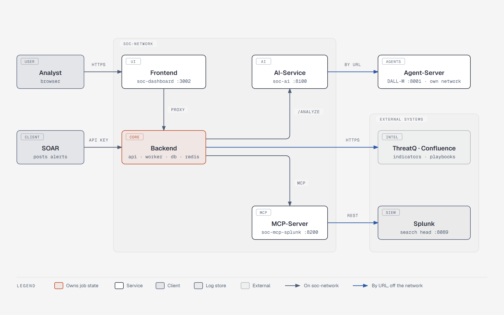

# MCP-Server

Connectors that give the Backend access to outside systems over MCP. The Backend
holds no Splunk credentials: it sends a question, and the connector writes the
search, checks that it is read-only, runs it, and returns the SPL and the rows.



| Folder | Container | Port | What |
| --- | --- | --- | --- |
| [Splunk/](Splunk/README.md) | `soc-mcp-splunk` | 8200 | The Splunk connector. One MCP tool, `splunk_lookup`. |
| [Confluence/](Confluence/README.md) | `soc-mcp-confluence` | 8600 | The playbook space, read-only. Optional; nothing calls it yet. |
| [external/splunk/](external/splunk/README.md) | `soc-splunk` | 8000, 8089 (this machine only) | A Splunk Enterprise container to search. |

No port is published except Splunk's own. The Backend reaches the connectors by
container name on `soc-network`.

## Run

Pick where searches run with `SPLUNK_MODE` in `.env`.

**Mock.** Fixed sample events, no Splunk needed:

```bash
docker network create soc-network     # once
cp .env.example .env                  # SPLUNK_MODE=mock; MCP_AUTH_TOKEN = the value in Backend/.env
docker compose up -d --build
```

**Live, against the Splunk container:**

```bash
cd external/splunk
cp .env.example .env                  # set SPLUNK_PASSWORD (8+ characters)
docker compose up -d                  # first start takes a few minutes
python3 setup.py --write-env          # token, role, sample events; writes ../../.env
python3 load_raw_logs.py              # optional: the lab logs in Splunk/Raw logs
cd ../..
docker compose up -d --build
docker compose exec -T soc-mcp-splunk python check_connection.py
```

`check_connection.py` prints `{"connected": true, ...}` when the connector
reaches Splunk.

**Live, against your own Splunk.** Set `SPLUNK_BASE_URL` to the management port
(`https://<search-head>:8089`) and `SPLUNK_TOKEN` to a search-only token. Keep
`SPLUNK_VERIFY_SSL=true`; for an internal CA, put its PEM in `certs/` and set
`SSL_CERT_FILE=/certs/<file>.pem`. Full steps:
[Backend/docs/splunk-mcp.md](../Backend/docs/splunk-mcp.md).

**Confluence connector:**

```bash
docker compose --profile confluence up -d --build     # fill CONFLUENCE_* in .env first
```

## The lab logs

`external/splunk/load_raw_logs.py` loads the CSV files in `Splunk/Raw logs/`
into `index=main`. The first three are the real lab logs of the web server
KBTG-Bootcamp. The `gen_*` files are synthetic attack scenarios from
`external/splunk/generate_logs.py`, each mixed with ordinary activity. All of
them are also in `Splunk/Raw_logs.zip`.

| File | Sourcetype | Events | What is in it |
| --- | --- | --- | --- |
| `splunk_logs_apache.csv` | `access_combined` | 1,048,576 | Directory scan, web shell |
| `splunk_logs_sysmon.csv` | `sysmon` | 384 | Processes on the web server |
| `splunk_logs_wineventlog.csv` | `wineventlog` | 63 | Logons, service install |
| `gen_wineventlog_auth.csv` | `wineventlog` | 230 | Password spray and brute force on FS-01 (4625), then a 4624 |
| `gen_linux_secure.csv` | `linux_secure` | 401 | SSH brute force on web-02, a successful login, sudo |
| `gen_fortigate.csv` | `fortigate` | 2,764 | Internal port scan; beaconing to a C2 address every 60 s |
| `gen_dns.csv` | `bind_query` | 3,180 | DNS tunnelling over long TXT queries |
| `gen_sysmon.csv` | `sysmon` | 60 | Encoded PowerShell from Word; LSASS dump |

The real logs cover 24 Dec 2024 16:43 to 17:58 UTC, the synthetic ones
08:00 to 20:00 UTC on the same day. A search over "the last 24 hours" finds
none of them. Run the script again and nothing doubles: a file whose events are
already indexed is skipped. Each scenario has a playbook in Confluence
(`UC-AUTH-*`, `UC-NET-*`, `UC-EDR-002`, `UC-EDR-003`) whose detection rule
finds exactly that scenario.

To regenerate the synthetic files: `python3 generate_logs.py`. It uses a fixed
seed, so the output is the same each time.

The field names for these sourcetypes are described in
`Backend/catalog/splunk-catalog.json`.

## Settings

| Variable | Meaning |
| --- | --- |
| `MCP_AUTH_TOKEN` | Bearer token the Backend sends. Same value as `Backend/.env`. |
| `SPLUNK_MODE` | `mock` or `live`. |
| `SPLUNK_BASE_URL`, `SPLUNK_TOKEN` | Where Splunk is and how to sign in. Live mode. |
| `SPLUNK_ALLOWED_INDEXES` | Indexes a search may name. |
| `SPLUNK_SAIA_MCP_URL` | Splunk AI Assistant, to write SPL. Blank uses a template. |

Every setting is explained in `.env.example`.

## Tests

```bash
pip install -r tests/requirements.txt
python -m pytest
```

The tests need no Splunk and no running stack.

## More

- Deployment status and history: [docs/reference.md](docs/reference.md)
- The whole system: [../README.md](../README.md)
